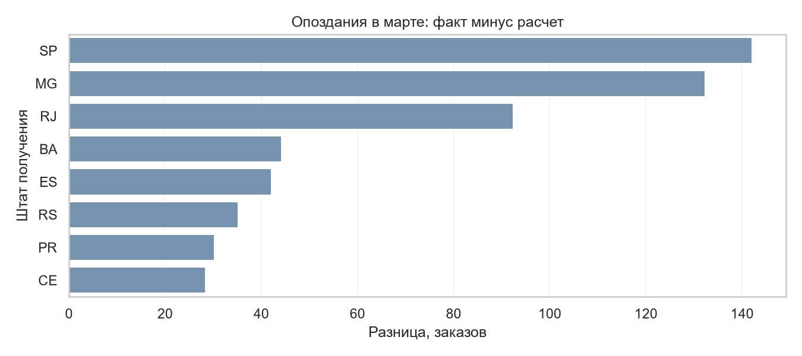

# E-commerce: анализ заказов Olist

Исследование заказов Olist за январь 2017 - июль 2018. Задача - найти
проблемный период доставки и определить, какие направления проверить первыми.
Дополнительно рассмотрены стоимость заказов, повторы, когорты и RFM-группы.
Это самостоятельный проект на открытых данных, без реального заказчика.

[Ноутбук с расчётами и выводами](e_commerce.ipynb).

## Основные результаты

В рабочем периоде 89 860 завершённых заказов от 86 960 покупателей.
Стоимость товаров без доставки - 12,34 млн BRL.

- В марте 2018 года опоздали 18,96% доставленных заказов против 9,09%
  в декабре-феврале. Изменение распределения заказов между штатами рост не объясняет.
- SP, MG и RJ дают 52,29% разницы между фактическими опозданиями и расчётом
  по прежним долям каждого штата. Для этих направлений отобраны 753 заказа.
- После передачи перевозчику средний срок вырос с 11,82 до 12,97 дня,
  P90 всей доставки - с 28,25 до 32,19 дня. Одновременно обещанный срок
  сократился примерно на четыре дня. С этих этапов и направлений стоит начать проверку.
- Несколько заказов имеют 3,00% покупателей. При полном 30-дневном наблюдении
  дополнительный заказ спустя более суток есть у 0,62% новых для выгрузки клиентов.



Для графика мартовское число заказов каждого штата умножено на его долю
опозданий за декабрь-февраль. Разница с фактическим числом помогает выбрать
направления для проверки. Она не показывает число предотвратимых опозданий.

## Данные и правила

[Brazilian E-Commerce Public Dataset by Olist](https://www.kaggle.com/datasets/olistbr/brazilian-ecommerce),
версия 2. Использованы customers, orders и order_items.

Покупка - заказ `delivered`, месяц определяется датой оформления.
Клиенты считаются по `customer_unique_id`, заказы - по `order_id`.
Позиции сначала складываются до уровня заказа. В ноутбуке показаны проверки
ключей и связей, сверки количества записей и денежных сумм.

Анализ исторический. Причины различий и эффект действий не установлены.
Стоимость товаров не равна прибыли, RFM-группы не определяют отток.

## Инструменты

Python, pandas, Seaborn, Matplotlib, KaggleHub, Jupyter.
Зависимости указаны в [requirements.txt](requirements.txt).

## Запуск

В папке проекта создайте окружение и установите зависимости.
Windows, PowerShell:

```powershell
py -3.13 -m venv .venv
.\.venv\Scripts\python.exe -m pip install -r requirements.txt
```

macOS / Linux:

```bash
python3.13 -m venv .venv
.venv/bin/python -m pip install -r requirements.txt
```

Откройте `e_commerce.ipynb` в VS Code с расширением Jupyter и выберите Python
из `.venv`. Выполните ячейки с начала. При первом запуске нужен доступ к Kaggle:
три CSV автоматически загрузятся в `data/raw/`.

В архиве есть выполненный ноутбук, графики и результаты. Исходные CSV
и окружение не включены. При запуске обновляются `assets/` и `results/`.

## Результаты для дальнейшей работы

- [delivery_review.csv](results/delivery_review.csv) - 753 опоздавших заказа
  в SP, MG и RJ, с датами и величиной опоздания.
- [state_delay_comparison.csv](results/state_delay_comparison.csv) - сравнение
  штатов. `baseline_rate` и `focus_rate` хранят доли за декабрь-февраль и март
  от 0 до 1. `expected_late` - расчётное число опозданий,
  `excess_late` - фактические опоздания минус расчётные.

Автор исходного проекта: [DGrbnv](https://github.com/DGrbnv).
